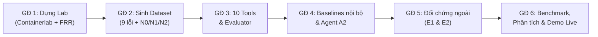

# Kế hoạch triển khai Dự án — Đề tài B2: ReAct Agent định vị nguyên nhân sự cố mạng

Kế hoạch này cụ thể hóa proposal [Group1_B2_Proposal.pdf](file:///c:/Users/Admin/NT539/Big-Project/Group1_B2_Proposal.pdf) thành lộ trình kỹ thuật rõ ràng, đảm bảo tiến độ, tính công bằng thực nghiệm và khả năng demo thực tế.

---

## 1. Kiến trúc & Cấu trúc thư mục dự án đề xuất

```text
Big-Project/
├── lab/                          # Hạ tầng Containerlab + FRRouting
│   ├── topology.clab.yml         # 6 router FRR (R1-R5, ISP), 1 switch SW1, 4 host
│   ├── configs/                  # Cấu hình chuẩn ban đầu (FRR, IP, OSPF cost, BGP)
│   └── scripts/                  # deploy.sh, reset_lab.sh, health_check.sh
├── datagen/                      # Pipeline gieo lỗi & sinh dataset
│   ├── injectors/                # 9 module gieo lỗi (bao gồm no_fault)
│   ├── noise_gen.py              # Sinh log nhiễu 3 mức (N0≈50, N1≈500, N2≈5000)
│   ├── collector.py              # Thu thập logs, vtysh, ip link, iptables, probes
│   ├── alert_gen.py              # Sinh alert.json theo triệu chứng người dùng
│   └── generate_dataset.py       # Chạy batch, gắn evidence_id, chia 30% dev / 70% test
├── tools/                        # 10 tool chỉ đọc (dùng chung cho mọi agent/baseline)
│   ├── schemas.py                # Pydantic schema cho input/output & evidence ID
│   ├── replay_backend.py         # Đọc từ snapshot/probe đã lưu (đánh giá)
│   ├── live_backend.py           # Chạy lệnh thật qua docker exec (demo)
│   └── network_tools.py          # 10 tool chuẩn hóa (search_logs, get_topology, ...)
├── baselines/                    # Đối chứng nội bộ & đối chứng ngoài
│   ├── h0_hot_device.py          # H0: thiết bị nhiều log bất thường nhất
│   ├── b0_playbook.py            # B0: cây quyết định cố định
│   ├── b1_single_shot.py         # B1 & B1-log: LLM đọc toàn bộ một lần
│   ├── e1_nika_react.py          # E1: tái triển khai NIKA-ReAct
│   └── e2_static_analyzer.py     # E2: Batfish-Static / phân tích tĩnh cấu hình
├── agent/                        # Hệ thống đề xuất (A2)
│   ├── prompts.py                # System prompt bối cảnh lab (topology, IP, cost chuẩn)
│   ├── graph.py                  # LangGraph ReAct (Thought → Action → Observation)
│   └── verifier.py               # Kiểm tra ràng buộc (≤15 calls, evidence ID có thật)
├── eval/                         # Đánh giá thống nhất
│   ├── evaluator.py              # Chấm Accuracy, NIKA 3-tier, NetOpsBench, Safety
│   ├── run_benchmark.py          # Chạy batch 7 cấu hình × 3 runs (N1) × N0/N1/N2
│   └── report_plots.py           # Xuất bảng kết quả, confusion matrix, biểu đồ
├── demo/                         # Giao diện/CLI demo chế độ Live & Replay
└── data/                         # Dataset sinh ra (dev/, test/) — gitignore nếu nặng
```

---

## 2. Lộ trình triển khai (6 Giai đoạn)



### Giai đoạn 1: Dựng Lab & Chuẩn hóa Baseline mạng (Tuần 1–2)
**Mục tiêu**: Có môi trường lab chạy ổn định, tái tạo nhanh trạng thái sạch.
- Thiết lập môi trường chạy Containerlab (Linux VM hoặc WSL2 trên Windows + Docker).
- Thiết kế và triển khai `topology.clab.yml`:
  - 6 router FRR (`R1–R5`, `ISP`), 1 Linux bridge (`SW1`), 4 host (`H1–H4`).
  - Vùng 1: segment `SW1` (`R1, R2, R3`) chỉ có 1 đường; Vùng 2: tam giác `R1–R4–R5` có đường dự phòng.
  - OSPF area 0 (AS 65001) giữa `R1–R5`; eBGP giữa `R1–ISP` (AS 65100).
- Tài liệu hóa **bản thiết kế chuẩn** (IP plan, OSPF cost/MTU/timer chuẩn, BGP ASN/peer) để dùng làm bối cảnh cho system prompt.
- Viết `health_check.sh` (verify hội tụ OSPF/BGP và `ping` thông suốt mọi cặp host) và `reset_lab.sh`.

> [!TIP]
> **Mốc nghiệm thu GĐ 1**: Chạy `deploy.sh` → mọi host ping nhau 100%, bảng định tuyến đúng thiết kế; `reset_lab.sh` khôi phục trạng thái sạch trong < 30 giây.

---

### Giai đoạn 2: Pipeline Gieo lỗi, Sinh nhiễu & Tạo Dataset (Tuần 2–4)
**Mục tiêu**: Tự động sinh hoàn chỉnh tập dữ liệu `dev` (30%) và `test` (70%) có nhãn sạch.
- Định nghĩa format dữ liệu chuẩn:
  - Gắn **`evidence_id` duy nhất** cho mọi dòng log (`log:<device>:<line_no>`) và mọi bản ghi snapshot/probe (`snap:<device>:<tool>:<key>`) ngay lúc thu thập để chống hallucination chính xác.
  - Thiết kế `label.json` chứa: `root_cause_node`, `fault_type`, `location_type` (gần/xa), `observability` (có/không log), `difficulty`, `required_evidence_patterns`.
- Cài đặt 9 fault injectors:
  1. `link_down_local`, `link_down_remote`
  2. `ospf_cost_misconfig`, `ospf_mtu_mismatch`, `ospf_timer_mismatch`
  3. `bgp_neighbor_misconfig`, `bgp_tcp_blocked`
  4. `acl_block_traffic`
  5. `no_fault`
- Cài đặt `collector.py` (gom `ospfd`/`bgpd` logs, `ip monitor link`, `vtysh json`, `ip -s -j link`, `iptables -L -n -v`, `ping`/`traceroute`) và `noise_gen.py` (bơm nhiễu có kiểm soát ở 3 mức `N0 ≈ 50`, `N1 ≈ 500`, `N2 ≈ 5.000` dòng).
- Chạy sinh dữ liệu (~111–180 incidents, nên cân nhắc tăng nhẹ lên ~150–180 để mỗi nhóm con có đủ mẫu) và viết script QA kiểm tra không có incident bị lỗi thu thập.

> [!IMPORTANT]
> **Quy tắc vàng**: Sau khi chia `dev`/`test`, **khóa chặt tập `test`**. Mọi bước tinh chỉnh prompt, tool và debug chỉ được thực hiện trên tập `dev`.

---

### Giai đoạn 3: Bộ 10 Tool chỉ đọc & Khung Evaluator thống nhất (Tuần 4–5)
**Mục tiêu**: Xây dựng lớp giao tiếp tool và hệ thống chấm điểm dùng chung cho mọi cấu hình.
- Cài đặt 10 tool chỉ đọc: `search_logs`, `get_topology`, `get_interface_status`, `get_ospf_neighbors`, `get_ospf_interface`, `get_bgp_summary`, `get_routes`, `get_acl`, `ping`, `traceroute`.
  - Thiết kế `search_logs` hỗ trợ lọc theo `device`, `keyword/regex`, `time_window`, `limit` để xử lý hiệu quả ở mức nhiễu `N2`.
- Cài đặt 2 backend: `ReplayBackend` (đọc file incident) và `LiveBackend` (`docker exec`).
- Chuẩn hóa JSON Output Schema (`fault_type`, `candidates`, `evidence`, `ruled_out`, `recommended_actions`).
- Cài đặt `evaluator.py` tính tự động:
  - Bộ chỉ số chính: Root-cause accuracy (top-1 node + fault_type), Localization (top-1/top-3), Fault-type accuracy + confusion matrix.
  - Bộ chỉ số chuẩn quốc tế: NIKA 3-tier (`detection / localization / RCA`) và NetOpsBench (`diagnosis score`, `fault-detection F1`).
  - Hiệu quả & An toàn: số tool calls, thời gian, token, tỉ lệ báo động giả/bỏ sót, tỉ lệ bằng chứng bịa (kiểm tra ID tồn tại), và bộ rule/rubric kiểm tra hành động nguy hiểm.

---

### Giai đoạn 4: Baselines nội bộ & Hệ thống đề xuất A2 (Tuần 5–7)
**Mục tiêu**: Hoàn thiện `H0, B0, B1, B1-log` và tối ưu `A2` trên tập `dev`.
- Triển khai các đối chứng nội bộ:
  - `H0` (Hot Device): đếm log bất thường theo thiết bị.
  - `B0` (Playbook cố định): cây quyết định `ping → route → OSPF → interface → BGP → ACL`.
  - `B1` & `B1-log`: gom toàn bộ snapshot/log vào 1 prompt (có chính sách xử lý rõ ràng khi log `N2` lớn).
- Triển khai `A2` (LangGraph ReAct Agent):
  - Vòng lặp *Thought → Action → Observation*, giới hạn cứng 15 tool calls.
  - System prompt cung cấp bối cảnh lab + hướng dẫn tư duy loại trừ giả thuyết (kiểm tra lỗi phía xa trên `SW1`, kiểm tra `ping`/`traceroute`/`acl`/`ospf cost` khi không có log).
  - Ép ràng buộc output JSON + trích dẫn `evidence_id` thật + nhánh `no_fault`/escalate khi thiếu bằng chứng.
- Đánh giá vòng lặp trên tập `dev`, phân tích lỗi sai của `A2` để tinh chỉnh prompt và mô tả tool.

---

### Giai đoạn 5: Đối chứng ngoài E1 & E2 (Tuần 7–8)
**Mục tiêu**: Tái triển khai công bằng hai phương pháp đại diện từ bên ngoài.
- **`E1` (NIKA-ReAct)**:
  - Triển khai theo đúng protocol NIKA (ReAct + LangGraph, phân tầng detection → localization → RCA), map vào cùng bộ 10 tool và output schema.
  - Đảm bảo ghi nhận rõ điểm khác biệt thiết kế giữa `A2` và `E1` (ví dụ: chiến lược prompt/workflow) để giải thích kết quả ở báo cáo.
- **`E2` (Batfish-Static / Static Analyzer)**:
  - Kiểm tra tính khả thi của Batfish với FRR + `iptables` trong tối đa 2–3 ngày đầu giai đoạn; nếu chuyển đổi định dạng quá phức tạp, sử dụng bộ **Static Config/State Analyzer** kiểm tra các bất biến thiết kế (OSPF cost/MTU/timer/area, BGP neighbor, route, ACL) trên đúng tập dữ liệu snapshot mà `A2` được phép đọc.

---

### Giai đoạn 6: Thực nghiệm chính thức, Phân tích & Demo Live (Tuần 8–10)
**Mục tiêu**: Thu số liệu hoàn chỉnh, làm báo cáo và sẵn sàng demo trực tiếp.
- Chạy benchmark trên tập `test`:
  - Toàn bộ 7 cấu hình (`H0, B0, B1, B1-log, A2, E1, E2`) ở `N0`, `N1` (chạy 3 lần với `temperature=0`, tính trung bình ± độ lệch chuẩn), `N2`.
- Tổng hợp kết quả theo các lát cắt yêu cầu trong proposal:
  - Theo vị trí lỗi (*gần* vs *phía xa*).
  - Theo khả năng quan sát (*có log* vs *không log*).
  - Theo mức nhiễu (`N0 → N1 → N2`) và độ khó.
  - So sánh chi phí (token/latency/tool calls), độ an toàn (hành động nguy hiểm = 0) và tỉ lệ bịa bằng chứng (= 0).
- Xây dựng kịch bản **Demo Live**: gieo trực tiếp 2–3 sự cố tiêu biểu (1 lỗi phía xa trên `SW1`, 1 lỗi không sinh log như `acl_block_traffic` hoặc `ospf_cost_misconfig`) vào Containerlab đang chạy → cho `A2` chạy `LiveBackend` chẩn đoán theo thời gian thực.

---

## 3. Cấu hình kỹ thuật đã chốt & Phân công cho nhóm 2 thành viên

### 3.1 Cấu hình kỹ thuật đã chốt

| Hạng mục | Cấu hình đã chốt | Lưu ý kỹ thuật |
| :--- | :--- | :--- |
| **Môi trường Lab** | **1 máy Linux riêng** (Docker + Containerlab) | Chạy native ổn định nhất cho FRR, Linux bridge `SW1`, `iptables` và `ip monitor`. |
| **LLM Backbone** | **DeepSeek API (`deepseek-chat`)** | Tương thích OpenAI SDK / `langchain-openai` (`base_url="https://api.deepseek.com"`), hỗ trợ tốt Tool Calling, JSON mode, `temperature=0` và có automatic context caching giúp giảm mạnh chi phí cho vòng lặp ReAct. |
| **Xử lý tràn context (`B1` ở `N2`)** | Giới hạn token đầu vào + ghi log rõ chính sách cắt | Ở `N2 ≈ 5.000` dòng log, cần đếm token trước khi gọi `B1`; nếu vượt context window của `deepseek-chat` thì ưu tiên giữ cửa sổ log quanh timestamp của `alert` và ghi nhận minh bạch trong báo cáo. |
| **Chạy Batch & Resilience** | Lưu checkpoint theo `incident_id` + retry/backoff | Tránh chạy lại từ đầu nếu gặp timeout/rate-limit trong quá trình benchmark 3× lặp lại. |
| **Cỡ tập dữ liệu** | ~111–180 incidents (30% dev / 70% test) | Nếu script sinh tự động chạy ổn, ưu tiên ~150–180 incidents để mỗi nhóm con có đủ mẫu thống kê. |
| **Phương án `E2`** | Batfish-Static hoặc Static Analyzer tự viết | Thử nghiệm Batfish tối đa 2 ngày; nếu vướng `iptables`/FRR thì chuyển sang Static Analyzer dựa trên snapshot (vẫn đảm bảo công bằng dữ liệu). |

### 3.2 Phân công song song cho 2 thành viên

Để 2 người làm song song mà không phải chờ nhau, **tuần đầu tiên hai bạn chốt chung Data Contract** (cấu trúc thư mục 1 incident, format `alert.json`, `label.json`, `evidence_id` và JSON snapshot), sau đó tách nhánh:

| Giai đoạn | Thành viên 1 (Network Lab & Data) | Thành viên 2 (Tools, Agent & Eval) |
| :--- | :--- | :--- |
| **Tuần 1–2** | Dựng `topology.clab.yml`, cấu hình chuẩn FRR (`R1–R5, ISP`), `SW1`, `H1–H4`, `reset_lab.sh`, `health_check.sh`. | Tạo 2–3 mock incident theo Data Contract; code `tools/schemas.py`, `ReplayBackend`, 10 tool chỉ đọc và `evaluator.py`. |
| **Tuần 2–4** | Code 9 fault injectors, `collector.py`, `noise_gen.py` (`N0/N1/N2`), `alert_gen.py`; sinh bộ dataset `dev`/`test` và chạy QA. | Code & test các baseline nội bộ (`H0`, `B0`, `B1`, `B1-log`) trên mock data rồi chạy thử trên tập `dev` ngay khi có. |
| **Tuần 5–7** | Code `LiveBackend` (`docker exec`), kiểm thử trực tiếp trên Containerlab; triển khai `E2` (Batfish / Static Analyzer). | Code & tinh chỉnh Agent `A2` (LangGraph + DeepSeek `deepseek-chat`) và `E1` (NIKA-ReAct) trên tập `dev`. |
| **Tuần 8–10** | Hỗ trợ chạy benchmark, dựng kịch bản Demo Live trên máy Linux, kiểm tra định tính kết quả mạng. | Chạy batch benchmark chính thức trên tập `test` (`N0/N1/N2`, 3 runs `N1`), xuất bảng/biểu đồ và hoàn thiện báo cáo. |
